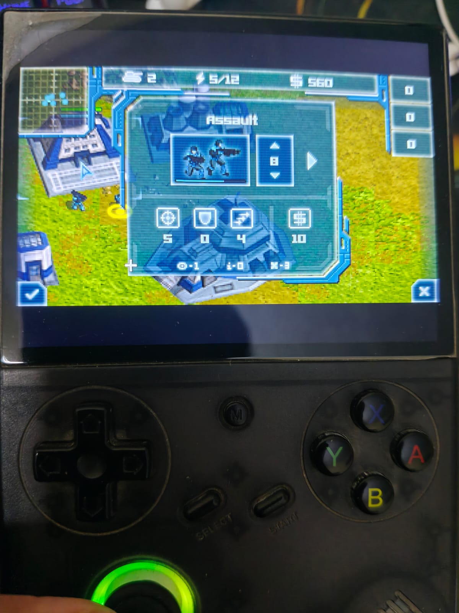
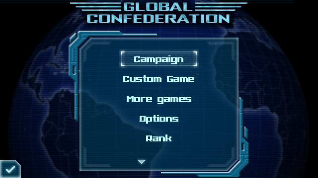
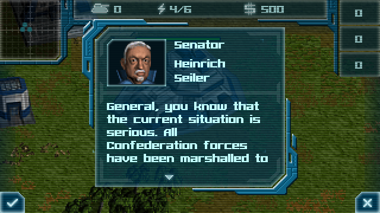
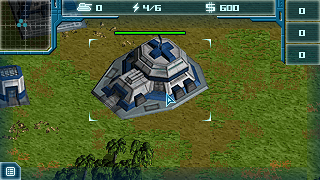
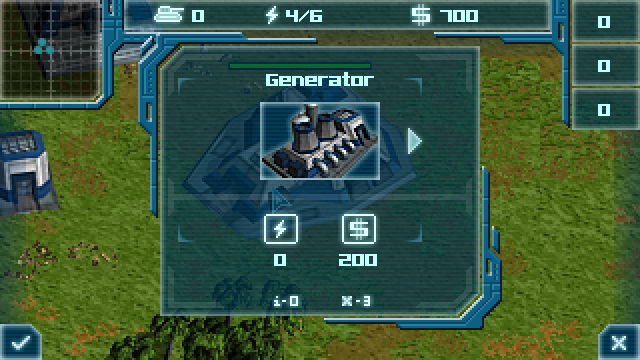
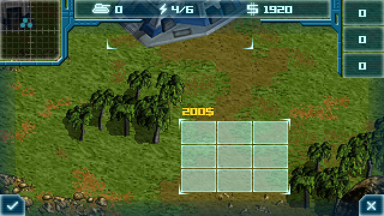
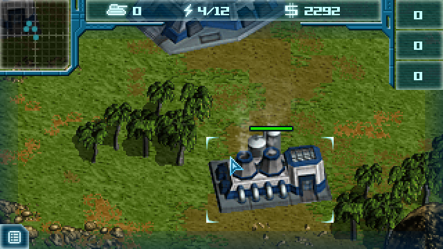
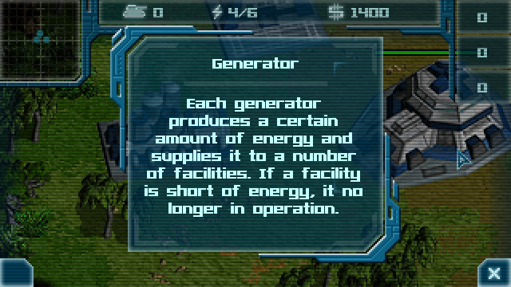
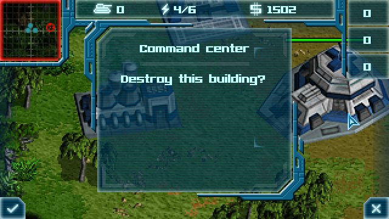

# Art of War 2: Global Confederation — native port for ARM64 handhelds

Runs the Nokia 5800 Java ME strategy game natively on Linux handhelds such as the Anbernic RG40XXV (KNULLI), packaged for [PortMaster](https://portmaster.games).

`aow2` is a small C++17/SDL2 program with a built-in Java runtime written for this one game. It loads the original classes from **your own** `ArtOfWar2__Nokia_5800.jar` and supplies the phone features they call: screen, images, touch and keys, saved games, timers and MIDI music. Rules, AI, missions and menus therefore behave exactly as on the phone. No Java installation, FreeJ2ME or RetroArch is needed.

**The game itself is not included.** Art of War 2: Global Confederation is © HeroCraft. You need your own copy of the Nokia 5800 edition, version 1.4.0.

<p align="center"></p>

| | |
| --- | --- |
|  |  |
| Main menu | Mission briefing |
|  |  |
| Mission 1, Pucallpa | Command Center build panel |
|  |  |
| Placing a Generator | Generator built, power 4/12 |
|  |  |
| Key 0: building information | Key 3: destroy building |

## Install on a handheld (PortMaster)

1. Build the package (below), then copy the contents of `dist/` into `roms/ports/` on the SD card.
2. Copy `ArtOfWar2__Nokia_5800.jar` into `roms/ports/artofwar2/gamedata/`.
3. Update the game list and start **Art of War 2 (Native)** from **Ports**.

Saves are kept in `roms/ports/artofwar2/saves/`. Each launch writes `roms/ports/artofwar2/log.txt`.

## Controls

The game was made for a touch screen. The left stick moves a pointer that acts as your finger. The phone's number keys, shown in the game's panels as `1`, `0` and `3`, are on the shoulder buttons and Select.

| Action | Handheld | PC |
| --- | --- | --- |
| Touch at the pointer (hold to drag) | A | Left mouse button |
| Move the pointer | Left stick (hold L2 for fine movement) | Mouse |
| Scroll the map, move the cursor | D-pad, or touch near a screen edge | Arrow keys |
| Fire / select at the cursor | Y | Enter or Space |
| ✓ button, pause menu | X or Start | F1 |
| ✗ button, back | B | F2 |
| Key 1: set the rally point of a production building | L1 | 1 |
| Key 3: destroy (sell) the selected building | R1 | 3 |
| Key 0: information about the selected unit or building | Select | 0 |
| Keys 7 and 9 in selection panels | R2 + L1, R2 + R1 | 7, 9 |
| Quit | Select + Start | Esc |

Answer ✓ to the game's "Sound on?" question for music, or start with `--mute`.

## Build

In Ubuntu (or WSL) with `build-essential cmake libsdl2-dev libpng-dev zlib1g-dev`, and the JAR in the project root:

```sh
cmake -S . -B build -DCMAKE_BUILD_TYPE=Release
cmake --build build -j
./build/aow2 ArtOfWar2__Nokia_5800.jar --scale 2
ctest --test-dir build        # boots the game headless to its main menu
```

For the handheld, with Docker:

```sh
tools/arm64/build.sh      # cross-compiles build-arm64/aow2 (Debian 12; needs glibc 2.36+ on the device)
tools/arm64/test.sh       # boots that binary to the main menu under QEMU
port/make-package.sh      # assembles dist/ for roms/ports/
```

The ARM64 binary is about 1.6 MB and needs only SDL2 and the C library from the device. `./build/aow2` with no arguments lists all options, including a headless mode driven by commands for automated testing.

## Project layout

| Folder | Contents |
| --- | --- |
| `runtime/` | JAR reader, Java runtime (interpreter, threads, garbage collector), phone API, MIDI synthesizer, SDL front end |
| `port/artofwar2/` | PortMaster port folder: launcher, `port.json`, `gameinfo.xml`, README, screenshot, licences |
| `tools/arm64/` | Cross-compiler and emulator images and scripts |
| `docs/` | Roadmap, technical notes, PortMaster publishing notes, screenshots |

## Status

Tested on an RG40XXV with KNULLI: the game plays, including base building, training, menus, saves and music. Not yet tested on other firmware, or through all seven missions. See the [roadmap](docs/Work%20-%20Native%20port%20roadmap.md) and [PortMaster publishing notes](docs/Work%20-%20Publishing%20on%20PortMaster.md).

## Credits

Art of War 2: Global Confederation by [HeroCraft](https://www.herocraft.com). This project contains no code or data from the game.

## Licence

The code in this repository is released under the [MIT License](LICENSE). The game itself is not covered and remains (c) HeroCraft.
